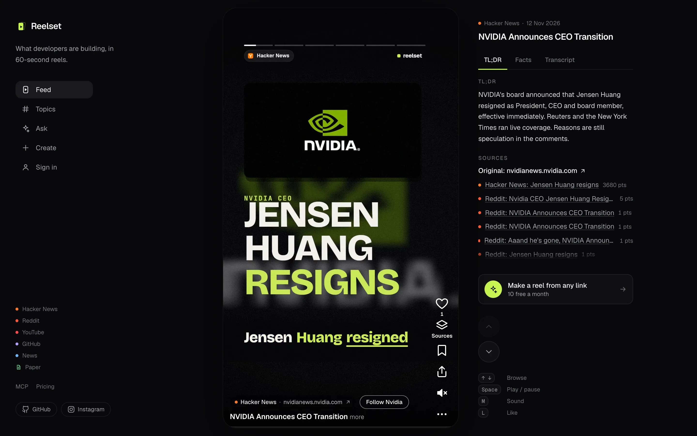
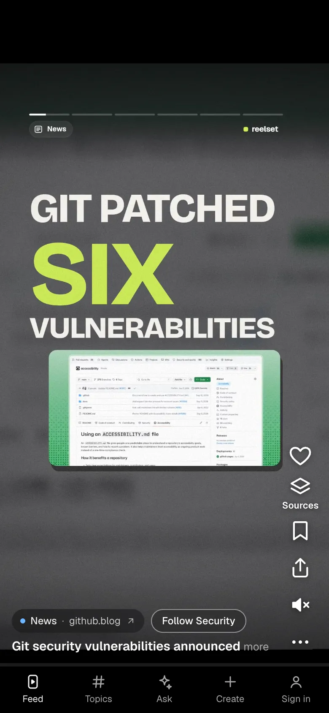
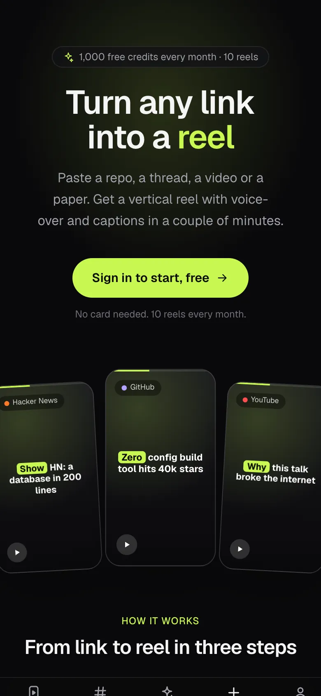

# Reelset

What developers are building, in 60-second reels.

Reelset ingests interesting developer projects, turns them into short vertical reels, and serves them in a reader app.

Try it at [reelset.app](https://reelset.app) · follow on [Instagram](https://www.instagram.com/reelset_app/)

<p align="center">
  <a href="https://reelset.app/r/nvidia-announces-ceo-transition-9b79e977"></a>
</p>

<p align="center">
  <a href="https://reelset.app/r/222cda38"></a>
  <a href="https://reelset.app/r/3693b6b4"></a>
  <a href="https://reelset.app/r/89c3a1dd"></a>
  <a href="https://reelset.app/create"></a>
</p>

## Make your own reels

Paste any link (a GitHub repo, an HN or Reddit thread, a YouTube video, an article or an arXiv
paper) at [reelset.app/create](https://reelset.app/create) and get a vertical reel with voice-over
and captions in a few minutes. Up to 5 links can go into one reel.

- **Free credits:** every account gets 1,000 credits a month, and one reel costs 100 (10 reels a
  month). Need more? Request an upgrade from your profile.
- **Already made?** If a link already has a reel, you get it instantly and are not charged.
- **Private by default:** your reels live on an unlisted link you can share or download as MP4.
  They join the public feed only after review.

### MCP server

Let your coding agent make reels for you. Reelset runs a remote
[MCP](https://modelcontextprotocol.io) server at `https://reelset.app/api/mcp` (Streamable HTTP).
Create an API key at [reelset.app/profile](https://reelset.app/profile#api-keys); setup snippets
for each client are at [reelset.app/mcp](https://reelset.app/mcp).

```bash
# Claude Code
claude mcp add --transport http reelset https://reelset.app/api/mcp \
  --header "Authorization: Bearer rs_live_..."
```

```json
// Cursor (~/.cursor/mcp.json)
{
  "mcpServers": {
    "reelset": {
      "url": "https://reelset.app/api/mcp",
      "headers": { "Authorization": "Bearer rs_live_..." }
    }
  }
}
```

| Tool              | What it does                                                                 |
| ----------------- | ---------------------------------------------------------------------------- |
| `generate_reel`   | Turn 1 to 5 public links into one reel; returns a `request_id` (100 credits) |
| `get_reel_status` | Check a request: each step, then the reel link and MP4 download when done    |
| `list_my_reels`   | Your recent reels and their status                                           |
| `publish_reel`    | Submit a finished reel for review so it can appear in the public feed        |
| `get_credits`     | Credits left this month and when they reset                                  |

Then ask your agent something like _"make a reel of github.com/ollama/ollama"_.

## Sources

Reelset pulls from six sources. The lists below are the defaults; admins can change them at
`/admin/settings` without a redeploy.

| Source      | Where it comes from                                                                                              | What gets picked up                                                                                                                                                                      |
| ----------- | ---------------------------------------------------------------------------------------------------------------- | ---------------------------------------------------------------------------------------------------------------------------------------------------------------------------------------- |
| Hacker News | [HN Algolia API](https://hn.algolia.com/api)                                                                     | Stories with 20+ points, plus top comments                                                                                                                                               |
| GitHub      | [GitHub search API](https://docs.github.com/en/rest/search)                                                      | New repos (not forks) with 50+ stars, with README and latest release; spam and cracked-software repos are filtered out                                                                   |
| Reddit      | [Arctic Shift](https://arctic-shift.photon-reddit.com) (Reddit archive API)                                      | Posts from r/programming, r/MachineLearning, r/LocalLLaMA, r/StableDiffusion, r/webdev, r/devops, r/ExperiencedDevs, r/selfhosted, r/singularity, r/OpenAI, r/ClaudeAI, r/rust, r/golang |
| YouTube     | YouTube search via `youtube-search-python`, transcripts via `youtube-transcript-api`                             | Videos from the last 7 days for searches like "open source AI model release", "coding agent review", "LLM benchmark comparison", "self-hosted AI" (12 queries)                           |
| News        | RSS/Atom feeds                                                                                                   | [GitHub Blog](https://github.blog), [Cloudflare Blog](https://blog.cloudflare.com), [Hugging Face Blog](https://huggingface.co/blog)                                                     |
| Papers      | [Hugging Face Daily Papers](https://huggingface.co/papers) and the [arXiv API](https://info.arxiv.org/help/api/) | Top 50 daily papers plus the newest 10 from cs.AI, cs.CL, cs.CV and cs.LG, from the last 7 days                                                                                          |

Every item is scored (votes, comments and growth per day), deduplicated across sources, then
turned into a TLDR and a reel script before rendering.

## Layout

| Path                                   | What it is                                                               |
| -------------------------------------- | ------------------------------------------------------------------------ |
| `apps/web`                             | Next.js app (reader, create, MCP server at `/api/mcp`, admin) on Workers |
| `workers/ingest`                       | Cloudflare Worker that discovers and ingests projects                    |
| `workers/render`                       | Cloudflare Worker + container that renders reels (Skia renderer, Python) |
| `packages/core`                        | Shared database schema, migrations and types                             |
| `scripts/smoke`, `scripts/maintenance` | Smoke tests and maintenance scripts                                      |
| `supabase`                             | Supabase config and auth email templates                                 |
| `docs`                                 | Infra notes and contracts                                                |

## Local development

Requires Node 22.12+.

```bash
npm install
cp .env.example .env.local   # then fill in values
npm run dev -w @reelset/web  # start the web app
npm test                     # tests in every workspace
npm run typecheck            # typecheck every workspace
npm run format               # prettier
npm run db:generate          # generate DB client from the schema
npm run db:check             # check migrations
npm run db:deploy            # apply migrations
```

Secrets live in `.env.local` / `.dev.vars` and are never committed.

## Deploy

See [docs/infra.md](docs/infra.md) for domains, Cloudflare, Supabase and the legacy Vercel setup.

The web app runs on the Cloudflare Worker `reelset-web` (OpenNext) and deploys from a local machine:

```bash
set -a; . <build env file>; set +a       # NEXT_PUBLIC_*, AUTH_COOKIE_DOMAIN, MEDIA_PUBLIC_BASE_URL, DATABASE_URL
npm run deploy:cf -w @reelset/web       # build, populate the R2/D1 caches, deploy
npm run preview:cf -w @reelset/web      # local workerd preview
```

Never run plain `wrangler deploy` for `apps/web`: it skips `populateCache`, so the incremental and tag caches go stale.

## Community

- Ideas and feature requests: [Discussions → Ideas](https://github.com/reelset/reelset/discussions/categories/ideas)
- Questions: [Discussions → Q&A](https://github.com/reelset/reelset/discussions/categories/q-a)
- Bugs: [Issues](https://github.com/reelset/reelset/issues/new/choose)
- Security: see [SECURITY.md](SECURITY.md)

Want to help build it? Read [CONTRIBUTING.md](CONTRIBUTING.md).

## License

[MIT](LICENSE)
