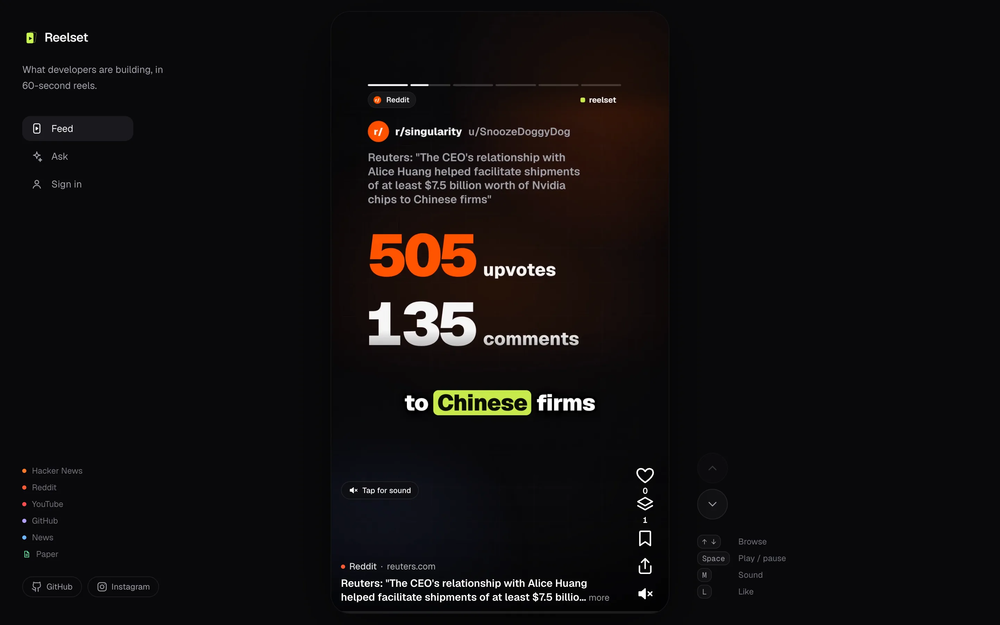
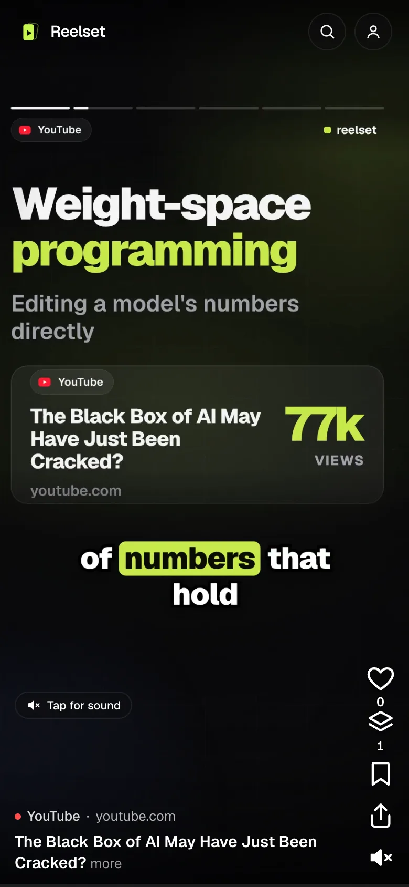
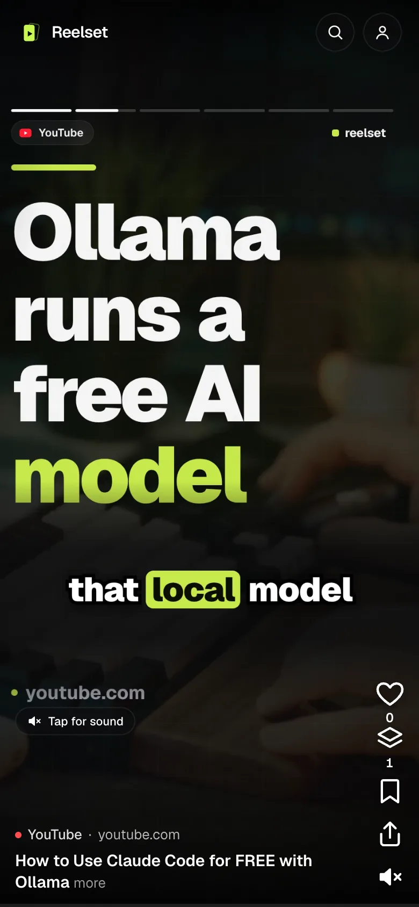
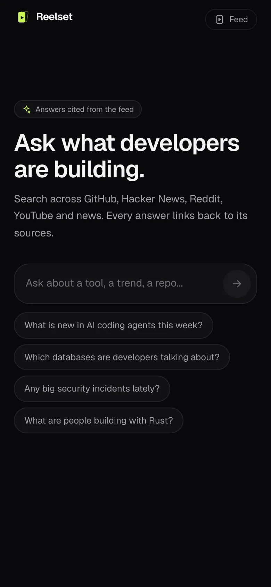

# Reelset

What developers are building, in 60-second reels.

Reelset ingests interesting developer projects, turns them into short vertical reels, and serves them in a reader app.

Try it at [reelset.app](https://reelset.app) · follow on [Instagram](https://www.instagram.com/reelset.app/)

<p align="center">
  <a href="https://reelset.app"></a>
</p>

<p align="center">
  
  
  
  
</p>

## Sources

Reelset pulls from six sources. The lists below are the defaults; admins can change them at
`/admin/settings` without a redeploy.

| Source      | Where it comes from                                                                                              | What gets picked up                                                                                                                                                                      |
| ----------- | ---------------------------------------------------------------------------------------------------------------- | ---------------------------------------------------------------------------------------------------------------------------------------------------------------------------------------- |
| Hacker News | [HN Algolia API](https://hn.algolia.com/api)                                                                     | Stories with 20+ points, plus top comments                                                                                                                                               |
| GitHub      | [GitHub search API](https://docs.github.com/en/rest/search)                                                      | New repos (not forks) with 50+ stars, with README and latest release; spam and cracked-software repos are filtered out                                                                   |
| Reddit      | [Arctic Shift](https://arctic-shift.photon-reddit.com) (Reddit archive API)                                      | Posts from r/programming, r/MachineLearning, r/LocalLLaMA, r/StableDiffusion, r/webdev, r/devops, r/ExperiencedDevs, r/selfhosted, r/singularity, r/OpenAI, r/ClaudeAI, r/rust, r/golang |
| YouTube     | YouTube search via `youtube-search-python`, transcripts via `youtube-transcript-api`                             | Videos from the last 7 days for searches like "open source AI model release", "coding agent review", "LLM benchmark comparison", "self-hosted AI" (12 queries)                           |
| News        | RSS/Atom feeds                                                                                                   | [GitHub Blog](https://github.blog), [Cloudflare Blog](https://blog.cloudflare.com), [Hugging Face Blog](https://huggingface.co/blog)                                                     |
| Papers      | [Hugging Face Daily Papers](https://huggingface.co/papers) and the [arXiv API](https://info.arxiv.org/help/api/) | Top 50 daily papers plus the newest 10 from cs.AI, cs.CL, cs.CV and cs.LG, from the last 7 days                                                                                          |

Every item is scored (votes, comments and growth per day), deduplicated across sources, then
turned into a TLDR and a reel script before rendering.

## Layout

| Path                                   | What it is                                                          |
| -------------------------------------- | ------------------------------------------------------------------- |
| `apps/web`                             | Next.js app (reader + admin), deployed on Vercel                    |
| `workers/ingest`                       | Cloudflare Worker that discovers and ingests projects               |
| `workers/render`                       | Cloudflare Worker + container that renders reels (Remotion, Python) |
| `packages/core`                        | Shared database schema, migrations and types                        |
| `scripts/smoke`, `scripts/maintenance` | Smoke tests and maintenance scripts                                 |
| `supabase`                             | Supabase config and auth email templates                            |
| `docs`                                 | Infra notes and contracts                                           |

## Local development

Requires Node 22.12+.

```bash
npm install
cp .env.example .env.local   # then fill in values
npm run dev -w @reelset/web  # start the web app
npm test                     # tests in every workspace
npm run typecheck            # typecheck every workspace
npm run format               # prettier
npm run db:generate          # generate DB client from the schema
npm run db:check             # check migrations
npm run db:deploy            # apply migrations
```

Secrets live in `.env.local` / `.dev.vars` and are never committed.

## Deploy

See [docs/infra.md](docs/infra.md) for domains, Cloudflare, Supabase and Vercel setup. The web app deploys from `main` via the Vercel Git integration (root directory `apps/web`).

## Community

- Ideas and feature requests: [Discussions → Ideas](https://github.com/reelset/reelset/discussions/categories/ideas)
- Questions: [Discussions → Q&A](https://github.com/reelset/reelset/discussions/categories/q-a)
- Bugs: [Issues](https://github.com/reelset/reelset/issues/new/choose)
- Security: see [SECURITY.md](SECURITY.md)

Want to help build it? Read [CONTRIBUTING.md](CONTRIBUTING.md).

## License

[MIT](LICENSE)
